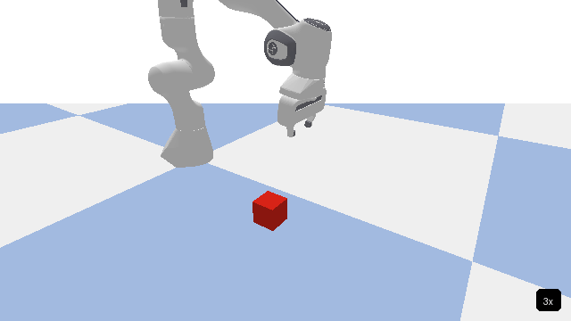
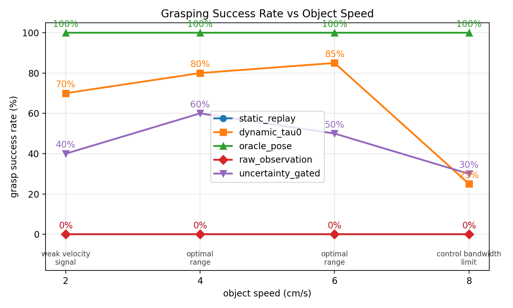

# MT3 Dynamic Alignment

Replay a static-object manipulation demonstration on a moving tabletop object using **Kalman filtering, latency compensation, and object-relative demonstration replay**. This is an independent extension study inspired by [MT3 (Multi-Task Trajectory Transfer)](https://www.robot-learning.uk/learning-1000-tasks).

**PyBullet simulation only · No policy retraining · No real-robot validation**

The featured ablation achieves **70%, 80%, 85%, and 25%** grasp success at **2, 4, 6, and 8 cm/s**, respectively, versus 0% for static replay (20 trials per speed and condition). These are the **2026-05-28 results with 15% random point-cloud dropout**, not the earlier no-dropout experiment. Grasp attachment is simulated with a fixed constraint; these are alignment/replay results, not a contact-rich grasping benchmark.

[Recorded demo](simulation/results/canonical/ablation_20260528_232432/grasping_demo.gif) · [Result chart](simulation/results/canonical/ablation_20260528_232432/grasping_success_rate.png) · [Raw trials](simulation/results/canonical/ablation_20260528_232432/raw_trials.csv) · [Reproduction guide](REPRODUCING.md) · [中文](README_CN.md)

[](simulation/results/canonical/ablation_20260528_232432/grasping_demo.gif)

Recorded simulation, shown at approximately 3x speed. The script generates and records a static grasp trajectory in PyBullet; it does not load a demonstration collected by the original MT3 hardware system.

## Results and evidence

[](simulation/results/canonical/ablation_20260528_232432/grasping_success_rate.png)

| Condition | 2 cm/s | 4 cm/s | 6 cm/s | 8 cm/s |
|---|---:|---:|---:|---:|
| Static replay | 0/20 (0%) | 0/20 (0%) | 0/20 (0%) | 0/20 (0%) |
| Dynamic replay (`dynamic_tau0`) | 14/20 (70%) | 16/20 (80%) | 17/20 (85%) | 5/20 (25%) |
| Raw observation | 0/20 (0%) | 0/20 (0%) | 0/20 (0%) | 0/20 (0%) |
| Uncertainty gate | 8/20 (40%) | 12/20 (60%) | 10/20 (50%) | 6/20 (30%) |
| Oracle pose | 20/20 (100%) | 20/20 (100%) | 20/20 (100%) | 20/20 (100%) |

Source: [`ablation_20260528_232432`](simulation/results/canonical/ablation_20260528_232432), seed 42, 20 trials per cell. Despite its historical name, **`dynamic_tau0` uses `TAU=0.1 s` in the code**, not zero prediction. The archive contains 480 rows, including 80 `pd_feedforward` trials excluded from the five-condition comparison because the earlier analysis reports an implementation bug. All rows are preserved.

The [personal website](https://block-o2.github.io/) uses this same archived chart and demo. The older [`plot/grasping_success_rate.png`](simulation/results/plot/grasping_success_rate.png) instead matches the May 24 no-dropout run (dynamic replay: 50%, 75%, 85%, 20%). Both runs and the earlier 10-trial development results remain available; see [analysis and limitations](ANALYSIS.md) and the [archive index](simulation/results/canonical/README.md).

These small, single-seed experiments support dynamic replay in this setup. They do not isolate the effect of prediction latency, establish a general optimal speed, or prove that filtering alone causes the improvement. The archived chart's speed-related causal annotations are hypotheses, not independently measured mechanisms.

## Method and contribution

```text
T_WE_target(t) = T_delta(t + tau) @ T_WE_demo(t_demo)
```

The tracker estimates the object's planar motion relative to the demonstration reference. A Kalman filter smooths that estimate and predicts ahead by `tau`; each demonstration pose is then transformed into the moving object's frame. Adaptive replay slows demonstration time when lateral alignment is poor.

The original MT3 authors introduced the alignment/interaction decomposition and retrieval-based trajectory transfer. This repository contributes the continuous planar tracking and replay implementation, constant-velocity/coordinated-turn models, prediction interface, adaptive progress gate, unit tests, and Panda simulation experiments. It does not reproduce the original paper's 1,000-task hardware study or its full retrieval pipeline. No learned policy is trained or retrained here.

## Quick Start

Use Python 3.11. From a new checkout:

```bash
git clone https://github.com/Block-O2/MT3-Dynamic-Alignment.git
cd MT3-Dynamic-Alignment
conda create -n dynamic_mt3 python=3.11 pip -y
conda activate dynamic_mt3
python -m pip install -r requirements.txt
python -m pytest tests/ -v
python examples/simulate_and_plot.py
```

The tests and synthetic example need no robot, ROS, camera, or PyBullet. The example writes three PNGs to a new root-level `results/` directory, separate from the archived experiments.

To inspect the archived scores without simulation dependencies:

```bash
python simulation/summarize_canonical.py
```

To run the current headless PyBullet experiment (400 trials; potentially hours):

```bash
python -m pip install -r requirements-simulation.txt
python simulation/10_grasping_experiment.py
```

It writes a new timestamped run under `simulation/results/canonical/`. This is a new five-condition run with the current code, not an exact reconstruction of the historical six-condition archive. See [REPRODUCING.md](REPRODUCING.md) for source-provenance gaps, rendering requirements, and checks actually performed.

## Code and documentation

| Path | Purpose |
|---|---|
| [`dynamic_alignment/`](dynamic_alignment) | Motion models, Kalman/EKF, point-cloud estimator, tracker and replay interfaces |
| [`tests/`](tests) | Hardware-free unit tests |
| [`examples/simulate_and_plot.py`](examples/simulate_and_plot.py) | Synthetic tracking and latency illustrations |
| [`simulation/10_grasping_experiment.py`](simulation/10_grasping_experiment.py) | Current Panda grasping ablation |
| [`simulation/dev/`](simulation/dev) | Earlier tracking and controller diagnostics |
| [ANALYSIS.md](ANALYSIS.md) / [中文分析](ANALYSIS_CN.md) | Both archived runs, conditions and interpretation |
| [EXPERIMENTS.md](EXPERIMENTS.md) | Development history, including earlier 10-trial results |
| [Design notes](MT3_dynamic_alignment_notes.md) | Derivation and proposed integration design |

## Integration status

The RealSense acquisition and object-segmentation methods in `pose_estimator.py` are stubs. Deployment still requires perception integration, calibration, time synchronization, latency measurement, controller integration, and real-robot validation. Sawyer + RealSense D415 is a proposed target, not a demonstrated deployment. The implemented tracker is planar SE(2); the grasping experiment disables PCA yaw estimation and tests translation along a semicircle.

## Upstream reference and permissions

Kamil Dreczkowski, Pietro Vitiello, Vitalis Vosylius, and Edward Johns. **Learning a Thousand Tasks in a Day.** *Science Robotics* 10, eadv7594 (2025). [DOI](https://doi.org/10.1126/scirobotics.adv7594) · [arXiv v1](https://arxiv.org/abs/2511.10110v1) · [Authors' project](https://www.robot-learning.uk/learning-1000-tasks).

The bundled paper PDF is not needed to install, test, or run this project. Its redistribution permission needs clarification: the PDF and arXiv comments restrict redistribution, while the arXiv license link points to CC BY-SA 4.0. It is retained unchanged pending clarification; use the official links above. See [the permissions review](REPRODUCING.md#paper-and-license-review). No repository license has been added because the authorization boundary is unresolved.
