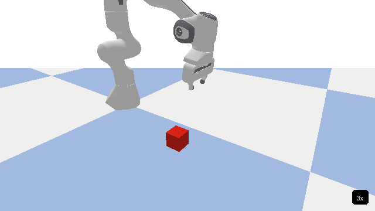
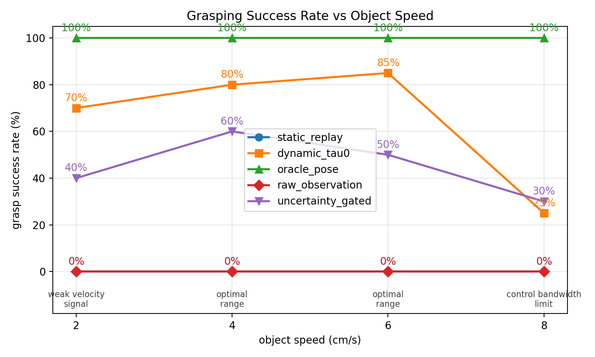

# MT3 动态对准

通过 **Kalman 滤波、延迟补偿与物体相对坐标系示教回放**，把静态物体上的操作轨迹应用到移动桌面物体。本项目是受 [MT3（Multi-Task Trajectory Transfer）](https://www.robot-learning.uk/learning-1000-tasks) 启发的独立扩展研究。

**仅 PyBullet 仿真 · 不进行 policy retraining · 未经真机验证**

当前展示采用 **2026-05-28、15% 随机点云丢帧**的实验：在 2/4/6/8 cm/s 下分别成功 **14/20、16/20、17/20、5/20（70%、80%、85%、25%）**，静态回放均为 0/20。方块使用固定约束连接夹爪；成绩反映对准与回放，不是完整物理接触抓取基准。

[Demo](simulation/results/canonical/ablation_20260528_232432/grasping_demo.gif) · [图表](simulation/results/canonical/ablation_20260528_232432/grasping_success_rate.png) · [原始 CSV](simulation/results/canonical/ablation_20260528_232432/raw_trials.csv) · [复现说明](REPRODUCING.md) · [English](README.md)

[](simulation/results/canonical/ablation_20260528_232432/grasping_demo.gif)

约 3 倍速的实际仿真录像。脚本在 PyBullet 内生成并记录静态抓取轨迹，没有加载原 MT3 真机系统采集的示教。

## 结果与版本

[](simulation/results/canonical/ablation_20260528_232432/grasping_success_rate.png)

| 条件 | 2 cm/s | 4 cm/s | 6 cm/s | 8 cm/s |
|---|---:|---:|---:|---:|
| static_replay | 0/20 (0%) | 0/20 (0%) | 0/20 (0%) | 0/20 (0%) |
| dynamic_tau0 | 14/20 (70%) | 16/20 (80%) | 17/20 (85%) | 5/20 (25%) |
| raw_observation | 0/20 (0%) | 0/20 (0%) | 0/20 (0%) | 0/20 (0%) |
| uncertainty_gated | 8/20 (40%) | 12/20 (60%) | 10/20 (50%) | 6/20 (30%) |
| oracle_pose | 20/20 (100%) | 20/20 (100%) | 20/20 (100%) | 20/20 (100%) |

来源为 `ablation_20260528_232432`，seed 42，每格 20 次。`dynamic_tau0` 是历史名字，**代码实际使用 `TAU=0.1s`，不是零预测**。归档含 480 行，其中 80 行 `pd_feedforward` 因此前分析报告的实现 bug 不纳入五条件比较，原始记录全部保留。

[个人网站](https://block-o2.github.io/)使用同源的 canonical 图和 GIF。旧 [plot 图](simulation/results/plot/grasping_success_rate.png) 对应 5 月 24 日无人工丢帧的 50%/75%/85%/20%；更早的每格 10 次开发结果也独立保留。来源、完整表格及解释边界见 [中文分析](ANALYSIS_CN.md)、[开发日志](EXPERIMENTS.md) 和 [归档索引](simulation/results/canonical/README.md)。

这些单 seed 小样本支持本场景下的动态回放，但没有隔离延迟预测的收益，也不能证明滤波是唯一改善原因、门控等效或存在普遍最佳速度。归档图中的速度机制注释属于假设。

## 方法与贡献

```text
T_WE_target(t) = T_delta(t + tau) @ T_WE_demo(t_demo)
```

跟踪器估计物体相对示教参考帧的平面运动，经 Kalman 平滑并向前预测，再变换每帧末端位姿。自适应回放在横向对准较差时放慢示教时钟。

原 MT3 作者提出 alignment/interaction 分解与检索式轨迹迁移。本仓库的增量是连续平面跟踪、CV/CT 运动模型、预测接口、自适应进度门控、单元测试和 Panda 仿真实验；没有复现原论文的千任务真机研究或完整检索链路，也没有训练或重训策略。

## 快速开始

使用 Python 3.11，从新检出开始：

```bash
git clone https://github.com/Block-O2/MT3-Dynamic-Alignment.git
cd MT3-Dynamic-Alignment
conda create -n dynamic_mt3 python=3.11 pip -y
conda activate dynamic_mt3
python -m pip install -r requirements.txt
python -m pytest tests/ -v
python examples/simulate_and_plot.py
```

测试和合成示例无需机器人、ROS、相机或 PyBullet。示例生成三张图到根目录 `results/`，与归档分开。

只读核验归档成绩（只需 Python 标准库）：

```bash
python simulation/summarize_canonical.py
```

当前无 GUI 的 PyBullet 实验（400 次，可能耗时数小时）：

```bash
python -m pip install -r requirements-simulation.txt
python simulation/10_grasping_experiment.py
```

输出写入 `simulation/results/canonical/` 下的新时间戳目录。当前五条件运行不等于精确恢复历史六条件归档；依赖、源码快照缺口和实际验证范围见 [REPRODUCING.md](REPRODUCING.md)。

## 文档与部署状态

核心代码见 [`dynamic_alignment/`](dynamic_alignment)，早期诊断见 [`simulation/dev/`](simulation/dev)，设计推导见 [研究笔记](MT3_dynamic_alignment_notes.md)。

RealSense 采集和物体分割仍为 stub；真机部署还需感知集成、标定、时间同步、延迟测量、控制器适配与硬件验证。Sawyer + RealSense D415 是拟议目标，并非已验证平台。跟踪器为平面 SE(2)，本抓取实验关闭 PCA yaw，仅测试往返半圆平移。

## 原论文与授权

Kamil Dreczkowski, Pietro Vitiello, Vitalis Vosylius, Edward Johns. **Learning a Thousand Tasks in a Day.** *Science Robotics* 10, eadv7594 (2025). [DOI](https://doi.org/10.1126/scirobotics.adv7594) · [arXiv v1](https://arxiv.org/abs/2511.10110v1) · [作者项目](https://www.robot-learning.uk/learning-1000-tasks)。

根目录 PDF 不参与安装、测试或仿真。PDF 及 arXiv 评论限制再分发，但 arXiv 许可链接指向 CC BY-SA 4.0，两者存在冲突。暂保留原文件，优先使用官方链接，待核实授权；未擅自添加仓库许可证。详见 [权限审查](REPRODUCING.md#paper-and-license-review)。
